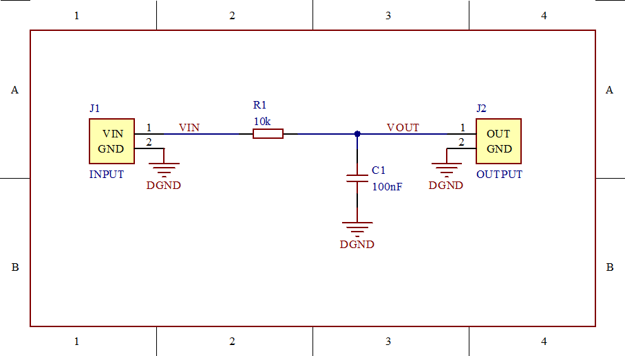
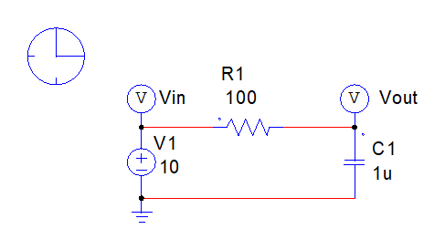

# AD and PSIM Skill

[简体中文](README.md) · **English**

AI engineering skills for Altium Designer and PSIM. An agent with local tools turns natural-language requirements into editable circuits, reference-based layouts, native validation and simulation results.

**Proprietary commercial project; not free or open source.** See [LICENSE](LICENSE) for authorization terms. WeChat: **1837620622**.

## Capabilities

| Skill | Main tasks | Native outputs and tools |
| --- | --- | --- |
| [AD modeling and schematic layout](skills/ad-schematic-layout/SKILL.md) | Create basic schematics, arrange existing circuits against a customer reference, compile in AD, compare pin-level connectivity and export drawings | SchDoc, PrjPcb, EMF/PNG; `native_ad.py` |
| [PSIM modeling, layout and simulation](skills/psim-simulation-layout/SKILL.md) | Create and modify native circuits, adjust layout and linked labels, run the solver and read actual parameters and waveforms | psimsch, SMV, CSV, EMF/PNG; `native_psim.py` |
| Layout and engineering checks | Pre-native layout check, netlist prediction under AD connection rules, text overlap and text-over-line review of native exports, connectivity comparison and time-weighted waveform measurements | Check reports and draft previews, netlist differences, review records and measurements; `check_layout.py`, `review_emf_text.py` |

The agent interprets the task, checks models, plans the layout and invokes the tools. This package supplies execution helpers and engineering methods. Complex devices, controller models and design targets still require project-specific verification. AD schematic compilation and PSIM circuit simulation are separate checks.

## Workflow and layout

1. Read the current requirements, source project and reference drawings; define the scope and deliverables.
2. Check software versions, native libraries, pins, parameters, coordinates and export behavior; validate a representative section first.
3. Build an editable circuit. Follow power or signal flow and keep supplies, clocks, sensing, compensation and feedback near the relevant devices.
4. Run the layout check until it reports 0 errors. `create` refuses to write a drawing that fails the check.
5. Save and reopen the native project. Compile and compare connectivity in AD; run the required operating conditions and read results in PSIM.
6. Native exports include a review of text overlap, clipping and text crossed by lines. Inspect the complete export and critical details, correct spacing, alignment, blank areas and clipping, then recheck electrical relationships.
7. Deliver the agreed files. Check archive CRC, extracted file hashes and native reopening.

Use conventional engineering drafting: a consistent grid, orthogonal local wiring, clear junctions and linked component text. Avoid arbitrary component matrices, decorative panels and excessive blank space. Grid, text placement, spacing, proportions and value notation are specified numerically in the [AD drafting rules](skills/ad-schematic-layout/references/drafting-rules.md) and [PSIM drafting rules](skills/psim-simulation-layout/references/drafting-rules.md). Layout-only changes preserve component parameters and port-level connectivity. Single-sheet or single-symbol requirements apply when requested for the current task.

See the [AD reference notes](skills/ad-schematic-layout/references/professional-gallery.md) and [PSIM reference notes](skills/psim-simulation-layout/references/professional-gallery.md). The public repository links to official sources and provides original guidance; it does not distribute customer screenshots or copies of vendor manuals.

## Requirements and installation

- An agent that can read local files, execute commands and inspect images.
- Windows with a working, appropriately licensed installation of AD or PSIM. PSIM also requires the Python API supplied with the application.
- Python 3.10 or later. Basic creation and measurement helpers mainly use the standard library. Pillow is optional for PNG rendering; olefile is optional for auxiliary reading of existing SchDoc files.
- Both skills follow the SKILL.md structure. Host-specific discovery is documented in [COMPATIBILITY.md](COMPATIBILITY.md).

The following commands are for users who have obtained the required authorization:

```powershell
git clone https://github.com/1837620622/ad-and-psim-skill.git
cd ad-and-psim-skill
python scripts/install_skills.py --profile common --profile claude --profile zcode
python scripts/install_skills.py --profile common --profile claude --profile zcode --check
```

Install only the profiles you need: `common` targets `~/.agents/skills`, which Codex, Gemini CLI, GitHub Copilot, Cursor, OpenCode and DSH all read; `claude` targets Claude Code, and `zcode` targets ZCode. The installer creates directory junctions on Windows and symbolic links elsewhere. Existing directories with different contents are preserved and reported as conflicts. It does not install AD/PSIM or grant software licenses.

Install optional dependencies in your own Python environment when needed:

```powershell
python -m pip install -r requirements-optional.txt
```

## Natural-language requests

The validated Codex environment discovers these skills with the package prefix shown below. Open a new session or refresh the skill list after installation. Use the names actually reported by other hosts.

**AD modeling and layout:**

```text
Use $ad-and-psim-skill:ad-schematic-layout to read my specification and reference.
Include only the required hardware. For this task, use one editable sheet and one complete DSP symbol.
Match the placement, typography and local wiring. Compile, compare connectivity and inspect each section before delivery.
```

**PSIM modeling and simulation:**

```text
Use $ad-and-psim-skill:psim-simulation-layout for the specified topology, ratings and controller.
Place the power stage above the nearby control and feedback circuits. Run startup, rated operation and required steps.
Check frequency, steady state, time resolution and power balance. Deliver the editable model, actual waveforms and drawings.
```

**Layout-only changes:**

```text
Rearrange the existing circuit to follow the attached reference.
Preserve devices, parameters and port-level connectivity.
Reopen natively, compare connectivity and properties, then inspect the complete export and critical details.
```

The skills do not depend on a model vendor: Claude, GPT, Gemini, Grok, DeepSeek, Qwen and others work when the host supplies local file, command and image tools. A chat model alone cannot operate desktop software. Layout quality is decided by numeric rules and automatic checks rather than model taste; see [COMPATIBILITY.md](COMPATIBILITY.md). A host can also load the relevant SKILL.md explicitly and resolve its references and scripts relative to that directory.

## Runnable basic examples

From the repository root, run the layout check with a draft preview, then create the basic AD RC schematic. Neither step needs AD, so both run on any system:

```powershell
python skills/ad-schematic-layout/scripts/check_layout.py skills/ad-schematic-layout/assets/rc-filter-plan.json --preview work/draft.png
python skills/ad-schematic-layout/scripts/native_ad.py create skills/ad-schematic-layout/assets/rc-filter-plan.json work/ad
```

For PSIM, set the actual installation directory, then create, simulate and export:

```powershell
$psimDir = "C:\Path\To\PSIM"
python skills/psim-simulation-layout/scripts/check_layout.py skills/psim-simulation-layout/assets/rc-filter-plan.json
python skills/psim-simulation-layout/scripts/native_psim.py --psim-dir "$psimDir" version
python skills/psim-simulation-layout/scripts/native_psim.py --psim-dir "$psimDir" create skills/psim-simulation-layout/assets/rc-filter-plan.json work/psim/RC_Filter.psimsch
python skills/psim-simulation-layout/scripts/native_psim.py --psim-dir "$psimDir" simulate work/psim/RC_Filter.psimsch work/psim-result
python skills/psim-simulation-layout/scripts/native_psim.py --psim-dir "$psimDir" export work/psim/RC_Filter.psimsch work/psim-preview/circuit.emf
```

Replace the example installation path with your actual directory. Use fresh output paths to avoid mixing old and new results. See the [AD execution guide](skills/ad-schematic-layout/references/execution.md) and [PSIM execution guide](skills/psim-simulation-layout/references/execution.md) for native compilation, export, parameter editing, linked text and plan formats.

These native exports are from self-contained RC examples. They demonstrate file generation and linked labels; complex circuit layouts require their own review.

**Complete native AD export** (open the image to inspect pins and labels):



**Native PSIM export** (blank margins cropped for reading):



## Validation and limits

The validation environment used AD Enterprise 26.4.1, PSIM 2026.0.0.7209 and Python 3.12. Checks covered AD creation, compilation, pin-level connectivity and native export; PSIM creation, parameter updates, saving, reopening, solving and linked-label export; and reopening or rerunning extracted copies.

The basic AD example compiled with 0 errors and 4 warnings. This is not a zero-warning or manufacturing approval claim. The 12 V PSIM RC validation differed from the analytical response by at most about 0.00015 V. That test does not cover every topology or controller model. See [validation details](docs/VALIDATION.md).

Run the portable helper checks with:

```powershell
python -m unittest discover -s tests -v
```

Actual Codex skill discovery was checked. Claude Code, Gemini CLI, GitHub Copilot, Cursor, OpenCode, ZCode and DSH have adapters for their documented discovery directories, but a complete design task was not run in each host. Grok and other models depend on their host integration. The native Windows backends have not been directly validated on macOS or Linux.

## Authorization, contact and issues

This is a **publicly visible proprietary commercial project**, without a default free-use or trial license. Rights granted by applicable law or platform terms, including permitted viewing and forking, are preserved. Other use, modification, integration and redistribution are governed by [LICENSE](LICENSE) and a separate written authorization. Sponsorship alone does not grant commercial rights.

- WeChat: **1837620622（传康Kk）**. Only sponsorship, commercial cooperation and licensing inquiries are accepted.
- Problems: [open an Issue](https://github.com/1837620622/ad-and-psim-skill/issues/new/choose) with software/agent versions, reproduction steps and relevant logs. Do not submit credentials or confidential customer projects.
- Product and vendor names identify compatibility targets and sources only. No official affiliation, certification or endorsement is implied. See [third-party notices](THIRD_PARTY_NOTICES.md).
