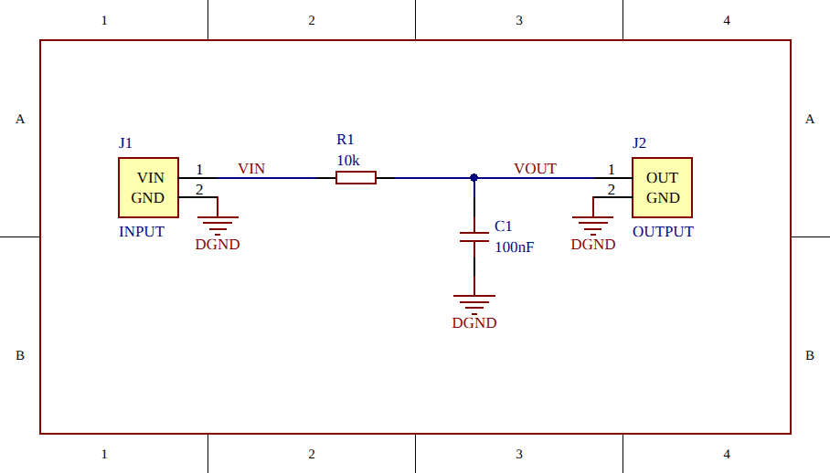
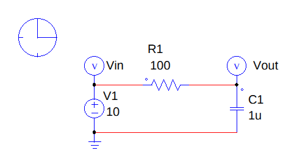

# AD and PSIM Skill

**简体中文** · [English](README.en.md)

[更新记录](CHANGELOG.md) · [实测记录](docs/VALIDATION.md)

[](LICENSE)


给 AI 编程助手用的两项技能：按一句话需求做出**可编辑的 Altium Designer 原理图**和**用 PSIM 真实求解的仿真模型**，排版按正式工程图的规则逐项检查。交付的是原生工程文件，不是图片。

可以在 Claude Code、Codex、Gemini CLI、GitHub Copilot、Cursor、OpenCode 等 Agent 里作为技能使用，也可以作为 MCP 服务器接入任何支持 MCP 的客户端。

> **专有商业授权，不是开源项目。** 使用、修改和集成需要书面授权，见 [LICENSE](LICENSE)。联系微信：**1837620622（传康Kk）**。

| | AD 示例 | PSIM 示例 |
| --- | --- | --- |
| Windows 原生导出 |  |  |
| Mac/Linux 仿原生（没装 AD/PSIM） |  |  |

第二行由本包在没装 AD、PSIM 的 Linux 上生成。和第一行的 Windows 原生导出逐像素比较：图像尺寸相同；只看线条和文字（不算白底），AD 有 97.8%、PSIM 有 97.0% 的像素在 1 像素内对齐，剩下的差别主要是文字边缘的抗锯齿。比较方法见 [docs/VALIDATION.md](docs/VALIDATION.md)。

## 能做什么

| | AD 原理图 | PSIM 仿真 |
| --- | --- | --- |
| 建模 | 生成 SchDoc + PrjPcb，在任何系统上字节一致 | 生成 Windows 构建包，由 PSIM 写出 psimsch |
| 改现有图 | 导入 SchDoc → 按操作清单修改 → 重新生成，连线自动正交重连 | 按操作清单修改计划，移动元件时导线自动绕开符号 |
| 排版检查 | 栅格、悬空线、隐式短路、预测网表、文字重叠与压线、穿件导线、画面密度、参数写法 | 导线、栅格、文字重叠与压线、导线穿符号、仿真控制位置、参数写法 |
| 预览 | 仿 Windows 原生出图（同比例、同线宽、ClearType 式文字）；接收 Windows 原生 PNG 后直接显示原图 | 仿 Windows 原生出图（同取景、按原生规则摆文字）；接收 Windows 原生 PNG 后直接显示原图 |
| 上 Windows 之前 | 预测编译 warning、网表和图面（`preflight`） | 按原生规则预测文字位置；线性电路离线预仿真（`presim`） |
| 跨系统交接 | Mac/Linux 准备任务，Windows 编译出图，再校验接收 | Mac/Linux 准备任务，Windows 原生求解，再接收 SMV/CSV 与原图 |
| 原生（Windows） | 编译、逐引脚网表比较、原生出图、窗口截图 | 建模、改参数、求解、波形读回、原生出图、窗口截图 |
| 结果核验 | 原生 EMF 上的文字重叠、越界、压线审查 | 同左；另有按时间加权的功率、效率、RMS、门极频率测量 |
| 交付 | 客户目录只放工程和图纸，过程文件另存归档，不打压缩包 | 客户目录只放模型和仿真结果，过程文件另存归档 |

## 工作流程

1. **写计划**：把需求整理成 JSON，写明器件、参数、坐标和连线。
2. **排版预检**（`check`）：有 error 就停下修改，不往下走。
3. **离线预测**（`preflight`）：仿原生预览、预计的编译 warning、PSIM 离线预仿真；`ready_for_windows` 为 true 再上 Windows。
4. **生成**：AD 写出 SchDoc + PrjPcb；PSIM 生成构建包，或在 Windows 上直接原生建模。
5. **原生核验**（Windows）：AD 编译并逐引脚比对网表；PSIM 原生求解并读回波形。
6. **原生出图**：检查文字重叠、越界和压线，再人工看图。
7. **交付**：客户目录加过程归档。

每一步都输出 JSON，模型逐条读取、逐条修正，不靠模型自己判断"差不多"。

## 运行要求

| 用途 | 需要 |
| --- | --- |
| 预检、生成、修改、渲染为 SVG、构建包、交付 | Python 3.10+（只用标准库），Windows、macOS、Linux 均可 |
| 渲染为 PNG | 仿原生出图需要 Pillow 和 Times New Roman/Arial（Windows、macOS 自带）或字宽相同的 Liberation 字体（Linux：`fonts-liberation`）；没有时用 resvg-py 或 Pillow 平滑渲染。可选依赖：`python -m pip install -r requirements-optional.txt` |
| Windows 原生 EMF 转 PNG、截图格式转换 | Python 3.11+、Pillow 13（已包含在上述可选依赖中） |
| 用 npx 安装或启动 MCP | Node.js 18+ |
| AD 编译与原生出图 | Windows + 已授权的 Altium Designer（验证过 Enterprise 26.4.1） |
| PSIM 原生建模、求解与出图 | Windows + 已授权的 PSIM 及其 Python 接口（验证过 2026.0.0.7209） |

其他软件版本没有验证过，不在承诺范围内。

可选依赖按 Python 版本安装：3.10 只装 resvg-py（只有平滑预览，没有仿原生出图）；3.11+ 另装 Pillow 13（仿原生出图、Windows 原生 EMF 转 PNG），不会退回带已知漏洞的旧版 Pillow。`render` 默认用仿原生出图（`--renderer gdi`），也可以用 `--renderer resvg` 或 `--renderer pillow` 指定，用 `--font-file`、`--font-dir` 指定字体文件。各后端的对比和字体说明见 [预览后端](docs/preview-backends.md)。

## Windows、macOS、Linux 都能用

AD 和 PSIM 只有 Windows 版。本包把能脱离软件完成的工作都做成了纯 Python：

| 工作 | Windows | macOS / Linux |
| --- | --- | --- |
| 写计划、排版预检、修改计划 | ✓ | ✓ |
| 仿原生预览、离线预测（`preflight`）、PSIM 离线预仿真 | ✓ | ✓ |
| AD：生成 SchDoc + PrjPcb | ✓ | ✓（文件与 Windows 上生成的完全相同） |
| PSIM：生成构建包 | ✓ | ✓（拷到装有 PSIM 的 Windows 电脑双击 `build.bat`） |
| AD 编译与出图、PSIM 建模与求解、窗口截图 | ✓（需装软件） | 交给有软件的 Windows 电脑 |
| 波形测量、整理交付 | ✓ | ✓ |

Mac/Linux 不用装 AD/PSIM：AD 文件可以直接在 Mac/Linux 上生成，交付前到 Windows 原生编译、出图；PSIM 模型和仿真结果都由 Windows 上的 PSIM 生成。具体做法见「使用」里的[在 Mac 或没装 PSIM 的电脑上做 PSIM 仿真文件](#在-mac-或没装-psim-的电脑上做-psim-仿真文件)和[在 Mac/Linux 上准备，交给 Windows 运行](#在-maclinux-上准备交给-windows-运行)。

### 怎样做到和 Windows 上看到的一样

- **同一份文件**：AD 的 SchDoc 在任何系统上生成都字节相同。
- **同样的出图**：仿原生渲染按 Windows 原生导出逐像素标定，包括像素比例、线宽、取整方式、ClearType 式彩边文字，以及 PSIM 的文字定位规则（文字起点 = AREA 水平中心 - FormatFactor）。
- **同样的字宽**：macOS 自带 Times New Roman 和 Arial；Linux 用字宽逐字相同的 Liberation 字体，文字位置和换行与 Windows 一致，只是字形细节略有不同。`env` 会显示当前用的是哪套字体。
- **提前知道结果**：`preflight` 预测 AD 编译会报的 warning（RC 示例预测 4 条缺少封装，与 Windows 实测一致）；PSIM 线性电路用与 PSIM 同类的算法（节点分析 + 固定步长梯形积分）离线预仿真，RC 示例与解析解最大偏差约 0.00003 V。
- **回来自动对账**：交接任务在 Windows 上运行后，返回结果里记录预测的 warning 数与实际是否一致，以及离线预仿真与 PSIM 波形的逐点偏差。

## 安装

### 方式一：npx（推荐）

```bash
npx -y github:1837620622/ad-and-psim-skill install            # 装到 ~/.agents/skills 和 ~/.claude/skills
npx -y github:1837620622/ad-and-psim-skill install --all      # 装到全部已知 Agent 目录
npx -y github:1837620622/ad-and-psim-skill doctor             # 检查 Python、Pillow、AD、PSIM
```

### 方式二：Skills CLI

```bash
npx skills add 1837620622/ad-and-psim-skill
```

### 方式三：CC Switch

在 CC Switch 的「Skills → 仓库管理 → 添加仓库」中填写：Owner `1837620622`，Name `ad-and-psim-skill`，Branch `main`，Subdirectory `skills`，然后安装两个技能。部分版本只识别根目录下的 SKILL.md，检测不到时改用方式一。

### 方式四：克隆后用 Python 安装

```bash
git clone https://github.com/1837620622/ad-and-psim-skill.git
cd ad-and-psim-skill
python scripts/install_skills.py                 # 默认装到 ~/.agents/skills 和 ~/.claude/skills
python scripts/install_skills.py --agent gemini --agent cursor
python scripts/install_skills.py --link          # 用链接，仓库更新后自动生效
```

安装器只替换它自己装过的目录，同名的其他目录会保留并报告冲突。`~/.agents/skills` 是 Codex、Gemini CLI、GitHub Copilot、Cursor、OpenCode 共同读取的目录；Claude Code 读 `~/.claude/skills`。各宿主的目录见 [兼容说明](COMPATIBILITY.md)。装完重新打开 Agent 会话。

### 检查、更新与卸载

```bash
npx -y github:1837620622/ad-and-psim-skill check        # 检查已装的是否为最新
npx -y github:1837620622/ad-and-psim-skill install      # 更新：重新安装即可覆盖旧版
npx -y github:1837620622/ad-and-psim-skill uninstall    # 只删除安装器装过的目录
```

用 Python 安装器时对应 `--check` 和 `--uninstall`；用 `--link` 安装的，`git pull` 后即为最新。

## 使用

### 直接说需求

```text
用 ad-schematic-layout 按附件的任务书和参考图画一张可编辑的 DSP 最小系统原理图，
只画要求的硬件，DSP 用一个完整符号。排版预检通过后在 Windows 上编译、出图，整理交付目录。
```

```text
用 psim-simulation-layout 按给定拓扑和额定值搭一个反激变换器，功率主路在上、控制和反馈在下。
跑启动、额定和负载阶跃，核对开关频率、稳态、步长和功率平衡，交付模型和真实波形。
```

```text
导入 work/old.SchDoc，只调整排版，器件、参数和连接都不变；预检通过后生成新图并渲染给我看。
```

需求里写清器件、参数、参考图和交付要求，结果会更接近你要的样子。

两个技能的 SKILL.md 都有“逐步操作（照着做）”一节：从示例计划开始，每一步该跑哪条命令、看 JSON 里哪个字段、出了哪种问题怎么改，都写成了固定步骤，便于能力一般的模型照着做到排版预检 0 error，再生成在 Windows 上打开的文件。

### 命令行

在仓库根目录运行（Windows PowerShell 里把变量写成 `$AD = "..."`，用 `$AD` 引用）：

```bash
# AD：任何系统
AD=skills/ad-schematic-layout
python $AD/scripts/native_ad.py check  $AD/assets/rc-filter-plan.json --preview work/draft.png
python $AD/scripts/native_ad.py create $AD/assets/rc-filter-plan.json work/ad
python $AD/scripts/native_ad.py render work/ad/RC_Filter.SchDoc work/ad/view.png

# PSIM：任何系统生成构建包，Windows 上双击 build.bat
PSIM=skills/psim-simulation-layout
python $PSIM/scripts/native_psim.py check   $PSIM/assets/rc-filter-plan.json
python $PSIM/scripts/native_psim.py package $PSIM/assets/rc-filter-plan.json work/psim-kit

# 上 Windows 之前：离线预测（仿原生预览、预计的编译 warning、PSIM 离线预仿真）
python $AD/scripts/native_ad.py preflight $AD/assets/rc-filter-plan.json work/preflight-ad
python $PSIM/scripts/native_psim.py preflight $PSIM/assets/rc-filter-plan.json work/preflight-psim
python $PSIM/scripts/native_psim.py presim $PSIM/assets/rc-filter-plan.json work/presim.csv
```

全部命令见 [AD 命令](skills/ad-schematic-layout/references/commands.md) 和 [PSIM 命令](skills/psim-simulation-layout/references/commands.md)。

### 在 Mac 或没装 PSIM 的电脑上做 PSIM 仿真文件

psimsch 只能由 PSIM 自己写出（原因见[常见问题](#常见问题)），所以分成两半：没装 PSIM 的电脑把能定的都定好，Windows 上只双击一次。

1. **写计划并预检**：`check plan.json` 到 0 error。文字压字、压线时，用 `plan-edit` 的 `place_text` 操作自动摆到不冲突的位置。
2. **离线预测**：`preflight plan.json work/preflight` 输出仿原生预览，并对线性电路离线预仿真（`presim.csv`），先确认拓扑、参数和波形量级；`ready_for_windows` 为 true 再往下走。
3. **打包**：`package plan.json work/psim-kit` 生成构建包；需要回传校验时改用下一节的 `handoff`。
4. **在 Windows 上双击**：把目录拷到装有 PSIM 和 64 位 Python 3.10+ 的 Windows 电脑，双击 `build.bat`。PSIM 写出 `名称.psimsch`，求解得到 `result\` 里的 SMV 和 CSV，原生出图到 `drawing\`，最后自动打开模型。
5. **出错时**：窗口停住显示原因，每一步的结果写在 `build-report.json`；改好后再双击一次。已有的 psimsch 会沿用，不覆盖你在 PSIM 里改过的内容，只重新求解和出图。

手边没有 Windows 电脑时，可以用 Windows 虚拟机或远程桌面连到装有 PSIM 的电脑。这两种方式本包没有验证过；PSIM 能否在虚拟机里运行、许可能否激活，以 PSIM 的说明为准。

### 在 Mac/Linux 上准备，交给 Windows 运行

没有 AD/PSIM 的电脑上用 `handoff` 准备一个任务目录，里面带好计划、执行脚本和离线预览：

```bash
python $AD/scripts/native_ad.py handoff $AD/assets/rc-filter-plan.json work/job-ad
python $PSIM/scripts/native_psim.py handoff $PSIM/assets/rc-filter-plan.json work/job-psim --name RC_Filter
```

把整个目录拷到装有软件的 Windows 电脑（还需要 64 位 Python 3.11+ 和 Pillow 13：`py -3 -m pip install Pillow==13.0.0`），双击 `run.bat`。软件位置会从注册表和常见目录自动查找，找不到时设置 `AD_EXE` 或 `PSIM_DIR`。AD 依次生成、编译、比对网表、原生出图；PSIM 依次建模、求解、原生出图。任何一步失败就停下，窗口停住显示原因，诊断信息留在 `native-results\`；改好后再双击一次，上次没通过的结果改名为 `native-results.failed-1` 等保留，已经通过的结果不会被覆盖。

把 Windows 上生成的 `native-results/` 拷回来（下例放在 `work/returned-ad`、`work/returned-psim`），再接收：

```bash
python $AD/scripts/native_ad.py receive work/job-ad work/returned-ad work/final-ad
python $PSIM/scripts/native_psim.py receive work/job-psim work/returned-psim work/final-psim
```

接收时逐个核对请求、计划和每个文件的 SHA-256；计划对不上、原生检查失败或文件被改过，都会拒收。PNG、SMV、CSV 原样复制，不重画、不重算。参数文件等依赖在准备时用 `--include params.txt` 带上。

任务目录里还带着 `preflight/` 的离线预测；Windows 运行后，返回清单的 `forecast` 一项记录预测和实际的对照（AD：预计与实际的编译 warning 数；PSIM：离线预仿真与 PSIM 波形的最大偏差）。

| 图 | 能说明什么 |
| --- | --- |
| 任务目录里的 `preview.render.png/svg` | 离线近似预览，用来查布局；字体和未标定器件可能与原生软件不同 |
| `receive` 结果里的 `png` | Windows 原生导出的原图，字节相同，可以确认软件里的实际图面 |

### 比较结果

```bash
python $PSIM/scripts/native_psim.py compare reference/native.csv work/final-psim/waveforms/native.csv --waveforms
python $AD/scripts/native_ad.py compare reference/drawing.png work/final-ad/drawing/RC_Filter.png
```

默认零容差、比较全部列，不插值、不平滑。结果分四级：`byte_identical`（文件字节相同）、`numeric_equal`（数值完全相等）、`within_tolerance`（在 `--atol`、`--rtol` 给定的容差内）、`different`。容差内相符不等于字节相同；不同软件版本、模型库或求解设置要分别核验。详见 [交接与比较](skills/ad-schematic-layout/references/handoff.md)。

### MCP

MCP 服务器只用 Python 标准库，提供 32 个工具，可以读取、修改、检查、渲染当前图纸，上 Windows 之前预测结果，准备交给 Windows 的任务，接收并比较原生结果。

```bash
claude mcp add ad-psim -- npx -y github:1837620622/ad-and-psim-skill mcp    # Claude Code
```

Cursor（`~/.cursor/mcp.json`）、Gemini CLI（`~/.gemini/settings.json`）等使用 `mcpServers` 的客户端：

```json
{
  "mcpServers": {
    "ad-psim": { "command": "npx", "args": ["-y", "github:1837620622/ad-and-psim-skill", "mcp"] }
  }
}
```

Codex（`~/.codex/config.toml`）：

```toml
[mcp_servers.ad-psim]
command = "npx"
args = ["-y", "github:1837620622/ad-and-psim-skill", "mcp"]
```

不想用 Node 时，把命令换成 `python`，参数换成 `["<仓库>/skills/ad-schematic-layout/scripts/mcp_server.py", "--with", "<仓库>/skills/psim-simulation-layout/scripts"]`。

<details>
<summary>32 个工具一览</summary>

| 用途 | AD | PSIM |
| --- | --- | --- |
| 环境检查 | `ad_env` | `psim_env` |
| 排版预检 | `ad_check` | `psim_check` |
| 上 Windows 前预测 | `ad_preflight` | `psim_preflight`、`psim_presim` |
| 读入与修改 | `ad_import`、`ad_edit` | `psim_plan_edit`、`psim_inspect`、`psim_edit` |
| 生成 | `ad_create` | `psim_package`、`psim_create` |
| 预览与截图 | `ad_render`、`ad_screenshot` | `psim_render`、`psim_screenshot` |
| 原生核验 | `ad_verify` | `psim_simulate`、`psim_measure` |
| 原生出图 | `ad_export` | `psim_export` |
| 交付 | `ad_deliver` | `psim_deliver` |
| 交接与接收 | `ad_handoff`、`ad_receive` | `psim_handoff`、`psim_receive` |
| 一致性比较 | `ad_compare` | `psim_compare` |

`ad_verify`、`ad_export`、`psim_create`、`psim_inspect`、`psim_edit`、`psim_simulate`、`psim_export` 需要 Windows 和对应软件；截图工具在没有软件时自动改用便携渲染；其余工具在任何系统上都能用。

</details>

## 排版标准

"好看"被写成了具体数字，并由程序判定，不依赖模型的审美：

1. **计划预检**：栅格、连接、文字间距、比例、密度和参数写法，0 error 才能生成文件。文字互相重叠是 error；位号和参数压字压线时，用编辑操作 `place_text` 自动摆到不冲突的位置。
2. **原生连接**（AD）或**原生求解**（PSIM）。
3. **原生图面**：在原生导出的 EMF 上查文字重叠、越界和被线穿过，然后人工看图。

规则全文：[AD 排版硬规则](skills/ad-schematic-layout/references/drafting-rules.md)、[PSIM 排版硬规则](skills/psim-simulation-layout/references/drafting-rules.md)。

## 截图

`screenshot` 命令在装有软件的 Windows 上会打开 AD 或 PSIM、等文档加载完、最大化后截取真实窗口；没有软件时改用便携渲染，结果里标明 `portable_render`。便携渲染用于调试，对外的图请用原生导出或真实截图。

## 交付

```bash
python $AD/scripts/native_ad.py deliver work/ delivery/ --name 项目名        # AD
python $PSIM/scripts/native_psim.py deliver work/ delivery/ --name 项目名    # PSIM
```

得到两个目录：

- `delivery/项目名/`：给客户，只有工程文件、仿真结果和正式图纸。
- `delivery/项目名-archive/`：自己留，放计划、脚本、报告、草图和每个文件的 SHA-256 清单。

不打压缩包；工作目录里的文件只复制、不移动。

## 常见问题

**没有 Windows 能用吗？**

能做计划、预检、生成 AD 文件、生成 PSIM 构建包或交接任务、渲染预览和整理交付。编译、求解、原生出图和窗口截图要在装有软件的 Windows 上完成，结果用 `receive` 原样接收回来。

**Mac 上生成的 AD 文件，客户打开会不会不一样？**

不会。生成器在任何系统上写出的字节完全相同，测试里固定了示例文件的 SHA-256。

**能不能在 Mac 上直接生成双击就能打开的 psimsch？**

不能。psimsch 是 PSIM 不公开的私有格式：文件开头只有明文版本号，正文经过编码；从外部生成 PSIM 原理图，Altair 给的途径是 PSIM 的 Python 接口，要在装有 PSIM 的电脑上运行。Typhoon HIL、SIMBA 这类商业工具要先在 PSIM 里导出网表才能读，在线设计工具生成 PSIM 模型时也是给出脚本、在 PSIM 里运行。所以本包在 Mac/Linux 上生成构建包：拷到装有 PSIM 的 Windows 电脑双击 `build.bat`，由 PSIM 自己写出 psimsch、求解、出图，最后自动在 PSIM 里打开做好的模型。完整步骤见[在 Mac 或没装 PSIM 的电脑上做 PSIM 仿真文件](#在-mac-或没装-psim-的电脑上做-psim-仿真文件)。AD 不一样：SchDoc 和 PrjPcb 在任何系统上都能直接生成，拷到 Windows 双击就能在 AD 里打开（也可以用 `native_ad.py open`）。跨系统交接用 `handoff` 和 `run.bat`，另有可校验的返回清单。

**技能和 MCP 选哪个？**

宿主支持技能目录就装技能：技能里有排版规则和完整流程。MCP 只提供工具，适合不支持技能目录的客户端；两者可以同时用。

**哪个模型效果最好？**

取决于宿主能不能让模型读文件、运行命令、看图，而不是模型品牌。不能看图的模型也能通过自动检查，但最后的看图审阅要交给能看图的模型或人。

**会不会改动我原来的工程？**

不会。导入只读取原图纸，修改写到你指定的新文件；PSIM 原生改参数另存副本；交付只复制文件。

**仿原生预览能直接给客户吗？**

不建议。它和 Windows 原生导出差别很小，但仍是预测出来的图；对外请用 Windows 原生导出，或用 `receive` 接收回来的原图。

**Linux 上的字为什么和 Windows 略有不同？**

Linux 默认用 Liberation 字体，字宽和 Times New Roman、Arial 逐字相同，所以文字位置、换行和是否压线都一致，只是笔画细节稍有差别。有授权的 Times New Roman、Arial 字体文件时，用 `--font-file` 指定即可。

**离线预仿真能代替 PSIM 吗？**

不能。它只支持线性元件（R、L、C、直流源、正弦源、电压探头），用来在上 Windows 前确认参数、拓扑和波形量级；有开关、二极管或控制电路时直接拒绝。交付的波形必须来自 PSIM。

## 目录结构

```text
ad-and-psim-skill/
├── skills/
│   ├── ad-schematic-layout/       # AD 技能：SKILL.md、references/、scripts/、assets/
│   └── psim-simulation-layout/    # PSIM 技能：同上
├── bin/cli.mjs                    # npx 入口：install / uninstall / check / mcp / doctor
├── scripts/install_skills.py      # Python 安装器
├── tests/                         # 可移植测试（不需要 AD、PSIM）
└── docs/                          # 验证记录和示例图
```

每个技能目录自成一体，复制到任何 Agent 的技能目录都能用。

## 验证状态

- 可移植部分（预检、生成、导入与修改、渲染、交接与接收、结果比较、离线预测与预仿真、MCP、安装器）有自动测试，其中仿原生出图直接和仓库里的 Windows 原生导出逐像素比较；CI 矩阵配置 Windows、macOS、Linux 与 Python 3.10/3.13：`python -m unittest discover -s tests -v`。实际运行情况见 Actions 和验证记录。
- 原生部分在 AD Enterprise 26.4.1、PSIM 2026.0.0.7209 上验证过；记录、边界和待复验的项目见 [docs/VALIDATION.md](docs/VALIDATION.md)。
- Codex 的技能发现实际验证过；其他宿主按官方文档的目录适配，未逐个运行完整设计任务。

## 授权与联系

本项目公开源码但**不是开源软件**，没有默认的免费使用或试用许可。法律和平台条款允许的浏览、fork 不受影响；其他使用、修改、集成和再分发需要书面授权，见 [LICENSE](LICENSE)。赞助本身不产生授权。

- 微信：**1837620622（传康Kk）**，只接受赞助、商业合作和授权咨询。
- 问题反馈：[提交 Issue](https://github.com/1837620622/ad-and-psim-skill/issues/new/choose)，写清软件和 Agent 版本、复现步骤、日志；不要上传账号凭据或客户保密工程。
- 第三方产品名称只用于说明兼容对象，不表示官方关联或背书，见 [第三方声明](THIRD_PARTY_NOTICES.md)。
